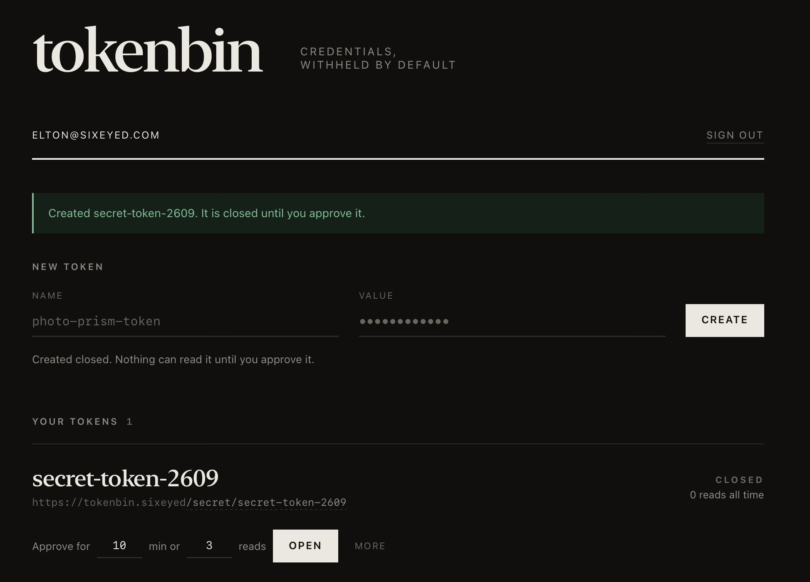
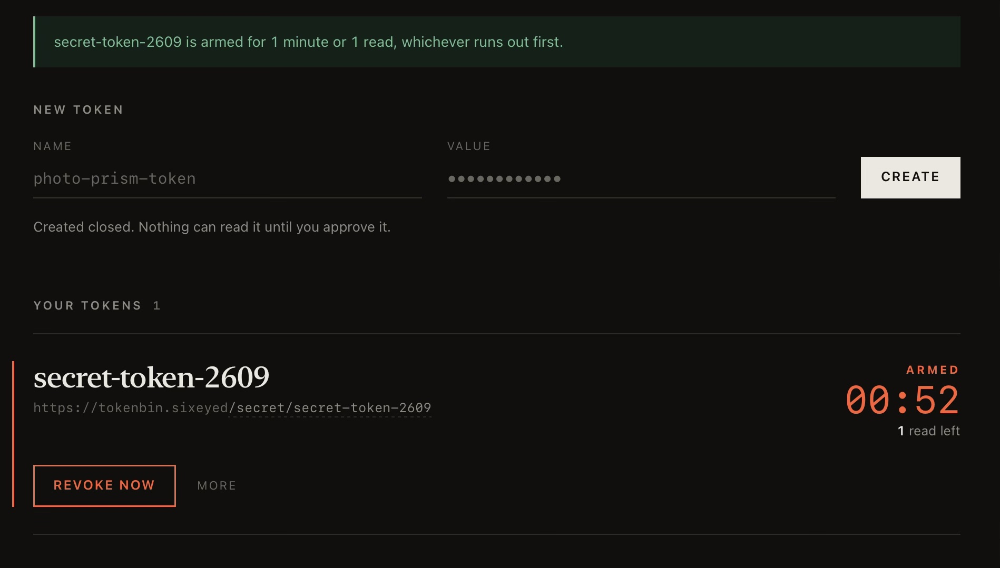
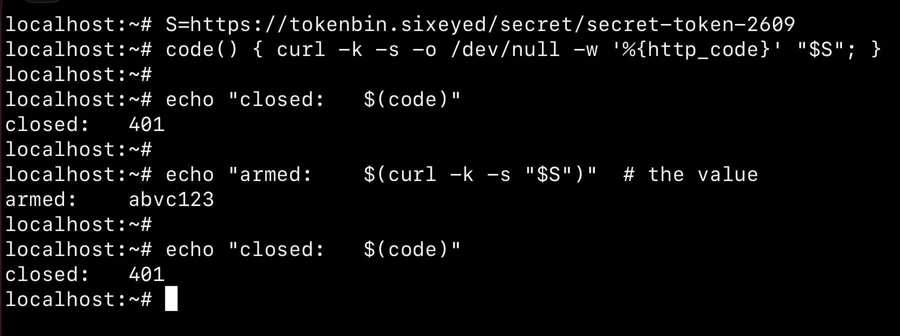

# 05 — Reference implementation

**Non-normative.** One way this was built, and — more usefully — the things that went
wrong. Treat the **Traps** section as the valuable part; several of those failures are
invisible in testing and only show up as a credential being readable when it should not
be.

## Shape

Python 3.12, FastAPI, Jinja2 templates, the standard library's SQLite, `cryptography`
for Fernet, Authlib for OIDC. Roughly 800 lines of application code and 69 tests.

Small on purpose. A service holding credentials should be auditable in one sitting, and
a thousand lines you wrote is far more auditable than ten thousand you inherited.

## Decisions worth repeating

**Ownership in the query, not after it.** Every owner-scoped operation is a single
statement constrained by name *and* owner. This is [§5.2](02-specification.md#5-ownership-and-identity)
and it is the highest-value structural choice here: there is no code path that can fetch
a record and forget to check who owns it, because fetching without the owner is not
something the code can express.

**One denial function.** Every failed read returns through a single function producing
one canonical response. New failure modes route into it rather than inventing their own
status. This is how [§4.1](02-specification.md#4-denial) survives contact with a
codebase.

**The value is write-only.** The owner can set and replace a value; nothing reads one
back to a page. There is exactly one code path that emits plaintext.

**Authenticated encryption.** Fernet, so a tampered ciphertext raises. This caught a
real bug: an early test accidentally pointed a second instance with a fresh key at an
existing database, and the failure was loud rather than silently returning junk.

**Fail closed on identity.** One dependency resolves the session or refuses, declared in
each protected route's signature — so whether a route is protected is answerable by
reading its definition rather than its body.

## Traps

### Building on an existing application

This started as a fork of a pastebin, chosen for UI reuse and a data model that already
had read counts and expiry. That was abandoned during design, and the reasoning
generalises.

The fork obliged us to hide secrets from every listing surface the host application
already had — list, archive, feed, QR, search. **A missed filter fails silently.**
Nothing errors; a credential simply appears on a page. That is a permanent tax on every
future change, and the moment the data model diverged, the reuse argument was gone
anyway.

If you build on something existing, **delete the routes rather than filtering them.**
And check what the host does automatically: the pastebin's garbage collector deleted
records that had not been read in N days, which for a rarely-used credential is exactly
the wrong behaviour, applied silently, to the entry you would miss most. That is why
[§1.1.4](02-specification.md#11-secret) forbids expiry outright.

### Concurrency on the last read

The read must verify the window, decrement, and audit as one atomic operation. Without
it, two callers racing a budget of one both see `reads = 1`, both succeed, and the budget
goes to `-1` or to `0` twice.

Here that is `BEGIN IMMEDIATE` around the whole sequence. Test it with real threads and a
barrier, asserting that exactly one of eight callers receives the value. It passes by
luck without the transaction if you only ever test sequentially.

### An error status is an oracle

The first version let a decryption failure propagate as a `500`. Every other failure was
a uniform `401`. An attacker who can distinguish the two has learned that a name exists.

Any distinguishable outcome is a leak, including ones that feel like faithful error
reporting. `404` for missing and `401` for closed is the most natural design in the
world and it is an existence oracle.

### Unencoded values in redirect headers

The dashboard signalled errors by redirecting with a message in the query string, built
by string concatenation. Those messages interpolate user-supplied names and submitted
values — so unescaped text went into a `Location` header. That is header injection, not
merely a rendering bug.

It surfaced only because a test asserted on the *rendered message* rather than on the
resulting state. Assert that the user was told why, not just that nothing happened —
[§8.4](03-acceptance-criteria.md#8-input-handling).

### The identity provider's URL means two things

The issuer URL is not an address, it is an identity: it is stamped into every token, and
the client reads the token and key endpoints out of the discovery document found there.
**It must resolve to the same provider from the browser and from the service.**

- **Locally**, the browser wants `localhost` and a container cannot use it, because
  `localhost` inside a container is the container. Putting the service in the provider's
  network namespace makes one name true for both, with no host-file edits.
- **In a cluster**, you cannot point the browser at a public name and the service at an
  internal one. Either let the service egress via the public name, or make the public
  name resolve internally to the service address.

Whatever you pick, an absolute callback URL must come from configuration, never from the
incoming request — [§8.2](02-specification.md#8-deployment). Behind a TLS-terminating
proxy the request looks like plain HTTP, and a callback derived from it is rejected as
an unregistered redirect. This is the single most common way OIDC integrations break.

### Authorize on the subject, display the address

Email addresses get reassigned. Using one as the ownership key means a new employee with
a recycled address inherits someone's credentials. Use the immutable subject identifier
and treat the address as a label.

Note that an authenticating *proxy* often forwards only the address, not the subject —
worth knowing before that architecture is chosen.

### Tests coupled to styling

Two tests asserted on CSS class names. A visual redesign broke them for no reason
related to behaviour, and the tempting fix — update the strings — trains you to edit
tests until they pass, which is precisely the wrong reflex in a security-relevant suite.

Assert on semantic markers the markup *means* — a state attribute — not ones it happens
to use for styling.

### Container build

Two defects that only mattered once images were published:

- **Dependencies installed from version ranges rather than the lockfile**, so a shipped
  image could contain versions no test had run against. Install from the lock.
- **No ignore file for the build context**, so the local environment file — holding the
  live encryption key — was sent to the daemon on every build. It never landed *in* the
  image, but on shared build machines that is not the standard to aim for.

For multi-architecture images, build each architecture on real hardware of that
architecture and join the results, rather than emulating both on one machine. Note that
where a builder uses the containerd image store, even a single-platform push is already
an index, which older manifest tooling refuses to nest — the newer `imagetools`-style
join handles it.

### Test invocation

Tests passed when run as a module and failed when run as a bare command, because only
one of those puts the working directory on the import path. Configure the path in
project settings rather than depending on how the suite is invoked — otherwise it works
locally and fails in CI for reasons unrelated to the code.

## The interface

A single page, signed in.

**Create** — two fields, name and value, and a button. The value field is a password
input; it is never rendered back.

**One row per secret**, showing the name, the full read URL (click to copy — people
paste this into scripts), and the state. An armed row shows a live countdown and the
remaining budget; a closed row shows lifetime reads and when it was last read.

**Approve is the primary action, and takes its parameters inline** — "Approve for `[10]`
min or `[3]` reads" — pre-filled from configuration, so the common case stays one click
while an unusual case does not require reconfiguring the service.

**Revoke replaces Approve when armed.** Rotate and delete sit behind a disclosure, so
the common path is uncluttered and the destructive ones need a deliberate reach.

Design notes that turned out to matter: make armed state visible at a glance across the
whole list — that is the one question the page exists to answer — and set countdowns in
tabular figures so digits do not jitter as they tick.

### The resting state, and the live one

Those two are the argument for the whole interface. Closed is inert; armed is
unmistakable. The difference is legible without reading a word, which matters because
the question the page exists to answer is *which of my credentials are readable right
now*.

### What a caller sees

Three commands, and only the middle one returns anything.

More in [screenshots/](screenshots/).

## Configuration used here

| Variable | Default | |
|---|---|---|
| `..._ENCRYPTION_KEY` | — | required; accepts `file:///path` |
| `..._SESSION_SECRET` | — | required; signs the session cookie |
| `..._DB_PATH` | `/data/store.db` | |
| `..._PUBLIC_URL` | `http://localhost:8000` | builds the OIDC callback |
| `..._OIDC_ISSUER` | — | |
| `..._OIDC_CLIENT_ID` | | |
| `..._OIDC_CLIENT_SECRET` | — | accepts `file:///path` |
| `..._APPROVAL_WINDOW` | `600` | seconds; the pre-filled default |
| `..._APPROVAL_READS` | `3` | the pre-filled default |
| `..._RATE_LIMIT` | `10` | denials per window per source |
| `..._RATE_WINDOW` | `60` | seconds |
| `..._DEV_IDENTITY` | unset | local bypass; refuses to start on an https public URL |

## Deployment notes

- **One instance only** while storage is single-writer embedded. Two race on the
  database, and each keeps its own in-memory rate limiter, silently doubling the
  threshold.
- **Back up the encryption key somewhere other than the host it runs on.** Losing it
  destroys every secret, irreversibly and by design.
- **Rotating the session secret is harmless** — it signs everyone out, nothing more.
- Run as a non-root user; the storage directory is the only path needing write access.
- Trust forwarded-address headers only from the proxy's own address, or the rate
  limiter can be bypassed by forging one.
