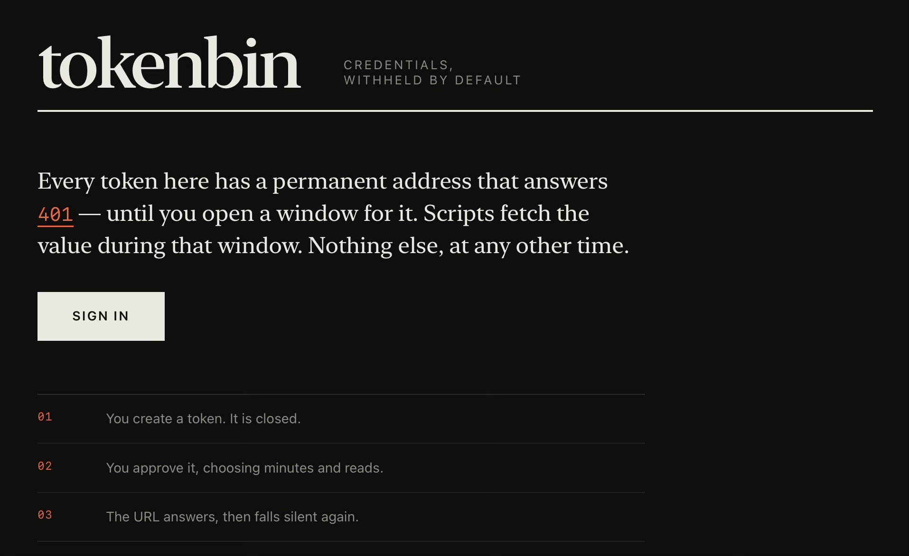
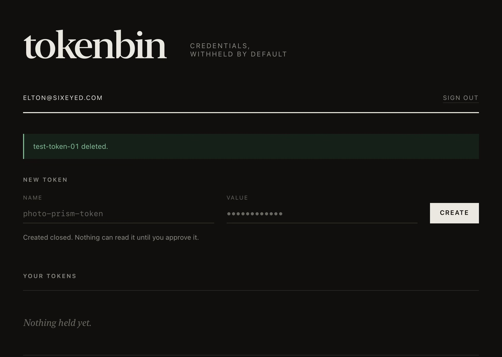
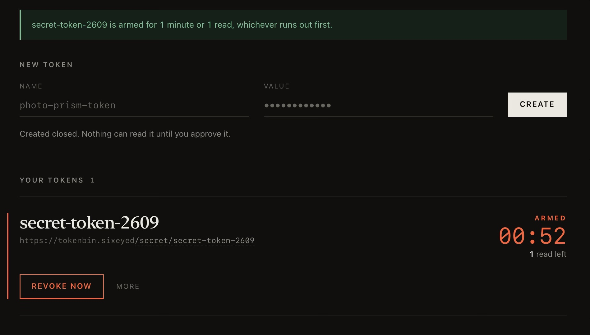
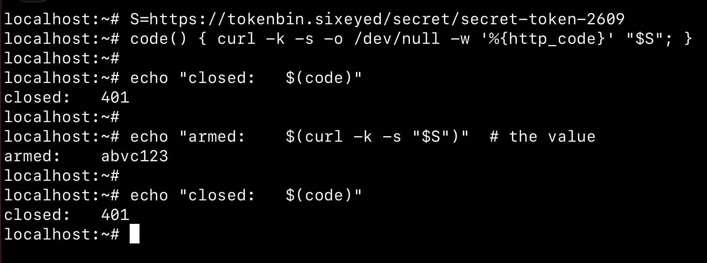

# Screenshots

From a running instance.

## The landing page

States the whole model before you have signed in or trusted it with anything.

## Holding nothing

The empty state explains the model rather than announcing a count of zero. Note the
create form's caption: a token is closed the moment it exists.

## Closed — the resting state

![One token, secret-token-2609, with its read URL and the label CLOSED, 0 reads all time. Below it: "Approve for [10] min or [3] reads" with an OPEN button, and a MORE disclosure](02-closed.jpg)

Entirely ink and grey. The approve control takes its window and budget inline, pre-filled
from configuration, so the common case stays one click while an unusual one does not
require reconfiguring the service.

## Armed

The accent colour is spent on exactly one thing: live state. A rule in the margin, the
label, the clock. Nothing else on the page competes for it.

This pair — closed above, armed here — is the argument for the whole interface. The
question the dashboard exists to answer is *which of my credentials are readable right
now*, and it should be answerable from across the room rather than by reading each row.

Both limits are stated together: `00:52` and `1 read left`. Whichever runs out first
closes the window.

## What a caller sees

Three commands, and only the middle one returns anything. Worth more than the other four
combined to anyone deciding whether they want this.

## Notes on capture

- Dark theme; the interface defines both.
- Cropped to the content column — full-window shots spend most of their pixels on
  browser chrome.
- The values shown are invented. The interface never renders a stored value back to its
  owner, so a real one cannot appear in a dashboard shot; the terminal is the only place
  a value is visible.
